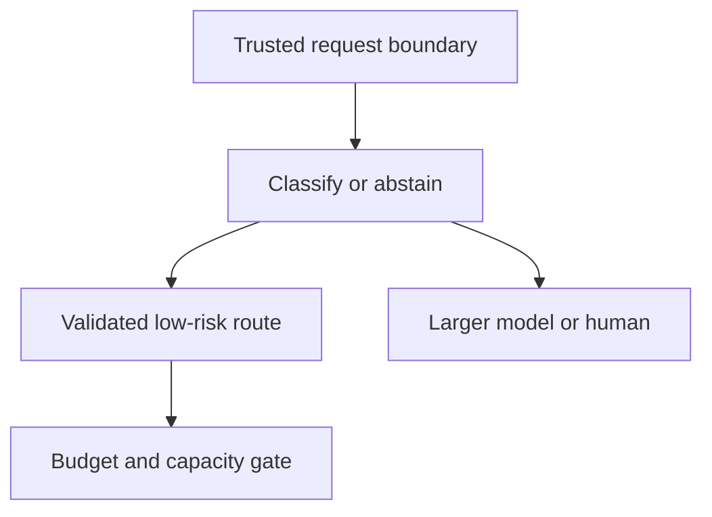

# Case - Routing Quality and Capacity

> [!abstract] Decision
> Choose between a cheaper classifier path, a larger model, and deferral under capacity pressure. Optimize cost per successful task subject to safety and latency—not price per token alone.

Prerequisites: [[Metrics That Decide]], [[Calibration]], [[Tokens, Context, and Cost]], [[Case - Serving Capacity]]. All measurements below are **constructed teaching data**, not vendor benchmarks or prices.

## Current engineering anchors

Cloudflare's September 17 [Workers AI changelog](https://developers.cloudflare.com/changelog/post/2026-09-17-reject-if-busy/) documents `rejectIfBusy`, allowing requests to fail immediately when capacity is unavailable instead of waiting in the queue. Admission control does not itself implement a safe fallback, retries, or a budget.

Vercel's October 2 [Jev for Python engineers](https://vercel.com/blog/jev-for-python-engineers) describes classifier-style typed choices through the Python AI SDK and illustrates limitations. Treat this as a classification/routing option to evaluate, not proof of arbitrary code-generation correctness or parity with every TypeScript SDK feature.

## The task contract

A synthetic support service classifies requests into documentation lookup, account action, or human review. Only authenticated application code may authorize an account action. A classifier may propose a route; it may not grant permissions.

Targets are chosen for this exercise: at least 97% correct routing overall, at least 99% recall on human-review-required cases, and p95 response time below 2 seconds for the interactive route. These are **teaching thresholds**, not industry standards.

## Candidate policy

Confidence alone cannot authorize a route. A calibrated confidence score is useful only on a relevant distribution; a schema-valid choice is not automatically a correct choice.

## Arithmetic you should recompute

Assume 1,000 independent task attempts. The classifier costs **$0.001 per attempt**; a larger-model call costs **$0.02**. These are invented unit costs and exclude infrastructure, labor, retries, and data transfer.

| Policy | Model-call cost | Correctly routed tasks | Cost per correct route |
|---|---:|---:|---:|
| Larger model for all | 1,000 × $0.02 = $20.00 | 980 | $0.02041 |
| Classifier for all; 300 escalate | $1.00 + 300 × $0.02 = $7.00 | 960 | $0.00729 |
| More conservative gate; 450 escalate | $1.00 + 450 × $0.02 = $10.00 | 978 | $0.01022 |

The cheapest policy fails the 97% overall target. The conservative policy passes the overall target, but that is not enough to ship.

Of 100 human-review-required examples, the conservative policy routes 98 to review: **98% recall**, below the 99% requirement. Overall accuracy masks the high-risk miss. Add a deterministic high-risk eligibility rule or improve the classifier, then evaluate on a fresh held-out set. Do not tune the threshold on these same 100 cases and report them as independent validation.

## Capacity failure changes the experiment

Suppose 10% of the 450 escalations are rejected at admission: **45 attempts**. If all retry immediately twice, up to **90 additional requests** are created. This arithmetic describes load, not guaranteed billing; providers may bill rejected/failed work differently.

Choose a bounded policy:

- Apply a request deadline and a small retry budget with backoff/jitter where appropriate.
- Preserve the task's idempotency key so retries do not duplicate side effects.
- Defer or offer a safe reduced-function path when capacity remains unavailable.
- Evaluate the fallback's quality and data boundary before enabling a second provider.
- Count deferred/abandoned requests in user-level success metrics; do not remove them to improve reported latency.

Queueing may be preferable for offline work. Fast rejection may be preferable when a caller can make a useful deadline-aware decision. Neither is universally best.

## What to log

Record policy version, task class, allowed route, selected model/version if exposed, admission outcome, retry count, token/call cost where available, total latency, completion outcome, and tenant budget attribution. Minimize raw content and redact secrets. Separate routing error from generation error and tool execution error.

Measure end-to-end p95/p99 and success by route, tenant, language, document size, and high-risk slice. Averages can hide queueing and minority-case failures.

## Free-first study path

Use a spreadsheet or a short local script with synthetic labels and mocked capacity outcomes. Optional managed experiments use Workers AI or provider-backed SDKs and may cost money. An SDK's open-source license does not make the model calls free. Verify current account quotas and retention terms before sending data.

## Quiz and answers

1. **Why reject the $7 policy?** It misses the chosen overall quality target.
2. **Why not immediately ship the $10 policy?** It misses the human-review recall threshold.
3. **Does immediate rejection solve overload?** No; unbounded retries can amplify it.
4. **Why include deferred tasks in the denominator?** They are real user attempts, not successful low-latency completions.
5. **Does valid JSON authorize an account change?** No; trusted identity and action policy must do that.

## Flashcards

Admission control::Deciding whether to accept work before adding it to an overloaded system.
Cost per successful task::Total relevant cost divided by successfully completed tasks under a stated contract.
Selective prediction::Allowing a model to abstain or escalate instead of forcing every decision.
Retry amplification::Extra load produced when failed requests trigger additional attempts.
Routing policy::A versioned rule for choosing a permitted execution path under quality, risk, cost, and capacity constraints.
High-risk recall::The fraction of truly high-risk cases correctly identified for the required treatment.

## Interview and suggested project

Explain why a 65% inference-cost reduction can still be a bad release. Bring the contract, slice results, timeout behavior, and user impact into the answer.

Suggested project: create a 200-row synthetic routing dataset, compare three policies, simulate capacity rejection, and write a decision memo. Report what you did not measure. Extend with a privacy-preserving trace schema rather than a bigger demo.
