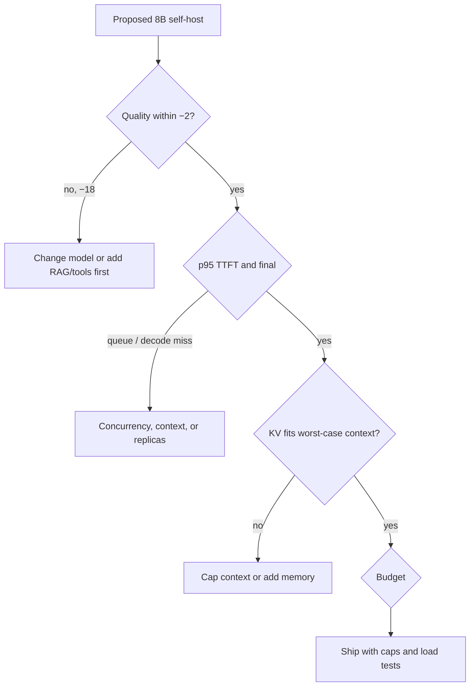

# Case · Serving capacity — can this SLO hold?

> [!abstract] Decision
> Product wants a streaming assistant at p95 time-to-first-token ≤ 800 ms and a monthly inference budget of $4,000. Decide whether the proposed shape can meet both, and what you would change first.

**Roles:** [[Inference and Performance Engineer]] · [[LLM Engineer]] · [[AI Platform Engineer]]
**Foundations:** [[07 Transformers and Foundation Models]] · [[13 Deployment MLOps and Economics]]

## Situation and contract

**Northline Credit — teaching scenario.** A new in-app assistant will serve authenticated employees. The proposed design is: one 8B open-weight model, self-hosted, continuous batching, 4k context, streaming.

Contract:

- Interactive chat, not batch scoring.
- p95 TTFT ≤ 800 ms; p95 time-to-final for a 200-token answer ≤ 6 s.
- Quality must stay within −2 points citation-supported@gold of the current hosted 70B-class teacher (0.80).
- Monthly inference budget envelope: $4,000 including idle capacity.
- Peak concurrent generations: 40.

## Teaching envelope

> [!warning] Constructed numbers
> Hardware prices and token speeds are teaching values so the arithmetic is checkable. Replace with profiler output before using this pattern in a real plan.

| Quantity | Value | Unit |
|---|---:|---|
| Peak concurrent generations | 40 | streams |
| Typical prompt | 1,200 | tokens |
| Typical completion | 200 | tokens |
| Measured prefill throughput (teaching GPU) | 8,000 | tokens/s |
| Measured decode rate, batch=1 | 80 | tok/s |
| Measured decode rate, batch=32 | 28 | tok/s per sequence |
| KV cache per token at current dtype | 0.5 | MiB |
| Usable GPU memory after weights | 40 | GiB |
| Teaching fully loaded GPU-hour cost | 2.40 | USD |
| Hours/month you will keep warm | 720 | always-on |
| Teacher citation-supported@gold | 0.80 | held-out |
| Draft 8B prompt-only citation-supported@gold | 0.62 | held-out |

KV cache for one 1,400-token live sequence ≈ 700 MiB. Forty concurrent sequences ≈ 28 GiB, which fits the 40 GiB teaching envelope with little headroom for longer prompts.

## Closed-note prompt

Compute, then decide:

1. Prefill time for 1,200 tokens at 8,000 tok/s. Is TTFT plausible?
2. Decode time for 200 tokens at the batch=32 per-sequence rate.
3. Always-on monthly GPU cost at $2.40/hour.
4. What breaks first: memory, TTFT, time-to-final, quality, or money?
5. What is the first intervention—bigger GPU, smaller context, distillation, cache, or stay hosted?

Show the arithmetic.

## Worked path

### 1. TTFT is mostly prefill plus queueing

Prefill time, no queue:

\[
1200 / 8000 = 0.15\ \text{s} = 150\ \text{ms}
\]

That is under 800 ms **if the request does not wait**. At 40 concurrent streams, a new request may sit behind a full batch. Queueing, not kernel speed, usually blows p95 TTFT. A capacity plan that quotes only single-stream prefill is incomplete.

Teaching rule of thumb: keep utilization with spare slots, or reject/queue visibly, rather than pretending p50 is p95.

### 2. Time-to-final

Decode at 28 tok/s per sequence when the batch is full:

\[
200 / 28 \approx 7.1\ \text{s}
\]

Plus 0.15 s prefill ≈ 7.3 s, **over the 6 s p95**. Batch=1 would be 200/80 = 2.5 s, but you cannot serve 40 concurrent users at batch=1 on one teaching GPU.

So the SLO fails at peak even before quality is considered.

### 3. Memory

\[
40 \times 1400 \times 0.5\ \text{MiB} = 28{,}000\ \text{MiB} \approx 27.3\ \text{GiB}
\]

Fits 40 GiB with ~12 GiB free. A 4k worst-case prompt pushes a single sequence to 2 GiB and forty sequences to 80 GiB — **OOM**. The advertised 4k context is not the working context you can offer at this concurrency.

### 4. Money

Always-on one GPU:

\[
720 \times 2.40 = \$1{,}728 / \text{month}
\]

Under $4,000. Money is **not** the binding constraint. Two GPUs for headroom still fit the envelope (~$3,456) if you actually need them.

### 5. Quality

0.62 vs a 0.80 teacher is an 18-point hole. The contract allowed −2 points. Serving an 8B that cannot meet quality is a failed plan even if latency were fine. Do not spend the week on kernels until the quality gap has an owner.



### 6. Decision

**Do not ship** the proposed shape.

Order of work:

1. Close quality (usually retrieval + the current teacher, or a larger/better student with measured evals). See [[Case - Prompt RAG Fine-Tune]].
2. Cap working context to a measured budget (teaching suggestion: 2k combined until profiled).
3. Load-test 40 concurrent streams; publish p95 TTFT **including queue**.
4. Add a replica if queueing violates TTFT; the budget can absorb a second GPU.
5. Only then spend time on quantization/speculative decoding, each gated on the quality set.

A hosted teacher with RAG may beat a heroic 8B serve on both quality and calendar time. That is an allowed outcome.

## Inspectable artifact

Capacity napkin a reviewer can recompute.

```text
# teaching capacity sheet — replace rates with profiler output
prefill_s          = prompt_tokens / prefill_tok_s
                   = 1200 / 8000 = 0.15 s
decode_s_peak      = completion_tokens / decode_tok_s_at_batch
                   = 200 / 28 = 7.14 s
ttft_p95_must_include_queue
kv_miB             = live_seqs * live_tokens * kv_miB_per_token
                   = 40 * 1400 * 0.5 = 28000 MiB
monthly_gpu_usd    = warm_hours * gpu_hour_usd
                   = 720 * 2.40 = 1728
binding_constraints: quality (−18 pts), decode SLO (7.1s > 6s), 4k@40 OOM
non_binding: monthly GPU cash
```

## Failure modes and reversal test

- Marketing quotes 4k context, serving grants 4k, production OOMs at 09:00 stand-up.
- Quantization recovers SLO and drops citation-supported@gold another 4 points — latency win, contract fail.
- Batching looks great in a synthetic identical-length benchmark and dies on real prompt-length mix.
- Always-on cost is fine; a second region doubles it and nobody reran the envelope.

## Quiz

1. Why is single-stream prefill not a p95 TTFT?
2. Compute KV MiB for 20 sequences × 2,000 tokens × 0.5 MiB/token.
3. What constraint was *not* binding in this envelope?
4. Why cap advertised context below model maximum?
5. When is a hosted larger model the correct serving answer?

> [!question]- Answer key
> 1. p95 includes queueing and batch wait, which dominate at high occupancy. 2. 20,000 MiB ≈ 19.5 GiB. 3. Monthly GPU cash. 4. KV memory scales with live tokens × concurrency; the max context is not simultaneously available to every stream. 5. When quality or calendar time dominates, and the hosted cost/SLO envelope is acceptable.

## Flashcards

Time to first token:: Delay from request arrival to the first streamed token, including queueing.

Inter-token latency:: Time between subsequent generated tokens during decode.

KV cache:: Stored keys and values for prior tokens, the usual memory limiter at concurrency.

Continuous batching:: Inserting new sequences as others finish so the GPU stays occupied.

Working context:: The context you can actually offer at the target concurrency without OOM.

## Transfer

- Interview: drill 4 in [[Technical Interview Drills]].
- Role: [[Inference and Performance Engineer]] study sequence step 5.
- Adjacent: [[Case - Evaluation Harness]] so optimization never ships on latency alone.
