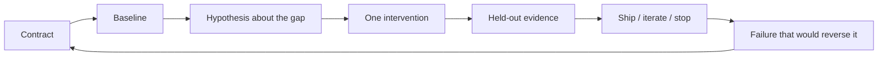

# How to study a technical case

> [!abstract] The goal
> A case is a rehearsal for ownership. Treat it as a timed design review, not as reading. The worked answer exists so you can grade your reasoning, not so you can memorize a preferred stack.

## Closed-note first

Set a 25–40 minute timer. Before opening the worked path, write:

1. **Contract:** user, task, unacceptable outcomes, latency/cost envelope, escalation rule.
2. **Baseline:** the simplest system that could satisfy the contract.
3. **Options:** two or three interventions, each aimed at a different hypothesized gap.
4. **Measurement:** what you would count, on what sample, with what stop rule.
5. **Decision:** what you would ship, pause, or reject, and the review trigger.
6. **Disproof:** the failure that would reverse the decision.

If you cannot write those six items, you are not ready for the worked path. Re-read the matching foundation note first.

## The studio loop

The loop is the same as [[Technical Role Deep Dive Framework]]. The studio supplies numbers so you can practice the arithmetic and the tradeoff, not only the vocabulary.

## Scoring rubric

Score yourself 0–2 on each row. 10/12 is a pass. 12/12 is not required; a missing unknown that you named is better than a confident fiction.

| Dimension | 0 | 1 | 2 |
|---|---|---|---|
| Contract | Tool-first or unbounded | Task named, limits vague | Users, exclusions, SLO, and escalation are explicit |
| Baseline | Jumps to the fashionable method | Names a baseline but does not use it | Compares every option to a runnable simpler system |
| Measurement | One demo score | A metric with no sample or gate | Representative + risk slices, uncertainty, decision threshold |
| Operations | “It works locally” | Mentions cost or latency | Budget, capacity, rollback, or recovery is part of the choice |
| Risk | Generic disclaimer | Names one threat | Permission, data, or safety control is enforced outside the model |
| Communication | Tool list | Partial rationale | A reviewer could execute or reject the decision from one page |

## Teaching numbers

Every studio case uses a **constructed teaching envelope**. That means:

- the company, traffic, and scores are invented for practice;
- units are internally consistent so the arithmetic is checkable;
- prices, model names, and hardware are illustrative of a class, not a quote;
- you should redo the arithmetic if you substitute current vendor numbers.

> [!warning] Do not cite teaching numbers as facts
> A case score is not a benchmark result. If you reuse the scenario in a portfolio, replace the envelope with measurements you actually ran and document lineage.

## How cases are built

Each case contains the same sections:

1. Situation and contract
2. Teaching envelope (checkable numbers)
3. Closed-note prompt
4. Worked path, including rejected options
5. Inspectable artifact
6. Failure modes and reversal test
7. Quiz, flashcards, and sources
8. Transfer: which role and interview drill this feeds

Write your own artifact before reading theirs. Then mark where they were stricter than you.

## After the case

- File a [[Decision Record Template]].
- Add one story to [[Interview Story Template]] using the decision, not the tools.
- If a calculation was the weak row, redo it with changed traffic or token length.
- If a risk row was the weak row, write the threat that your design still cannot see.

## Continue

Open [[Case - Prompt RAG Fine-Tune]].
