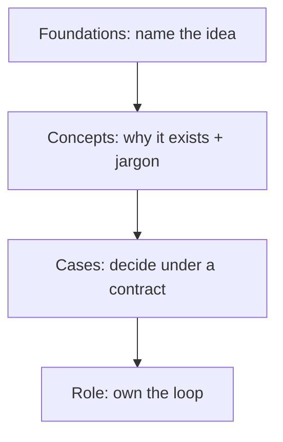

# Technical Skills Hub

> [!abstract] Outcome
> Learn the technical concepts that every builder-track role reuses, in plain language first: what the idea is, **why it exists**, what the jargon actually names, and what goes wrong when you skip it. Cases in [[Technical Studio]] then force a decision with those ideas.

Foundations give you a map. These notes teach the machinery. They are still not labs: you read, recompute the teaching numbers, and explain the term aloud. You do not follow a tutorial.

## Why this spine exists

A title like “LLM engineer” is a pile of reused ideas. If you cannot explain **token**, **held-out**, **precision**, **KV cache**, **grounding**, and **authority**, you will memorize tool menus and fail the first design review.

## Study order

Do them in this order unless a role note tells you to skip. Each note should take 25–40 minutes: read, hide the flashcards, recompute one table, explain one term to an imaginary non-engineer.

| # | Concept | The question it answers |
|---:|---|---|
| 1 | [[Tokens, Context, and Cost]] | What is the model actually counting, and why does that become money and latency? |
| 2 | [[Leakage and Contamination]] | Why can a beautiful score be fake? |
| 3 | [[Metrics That Decide]] | Which number should change a ship/stop choice? |
| 4 | [[Attention, Memory, and Inference]] | Why is generation slow, and what is a KV cache? |
| 5 | [[Context Engineering]] | What goes in the window, in what order, and what gets dropped? |
| 6 | [[Structured Outputs and Contracts]] | Why is model JSON untrusted? |
| 7 | [[Retrieval Quality]] | How do you know the right document was found and used? |
| 8 | [[Adaptation Methods]] | Prompt, retrieve, fine-tune, or train — which gap are you closing? |
| 9 | [[Embeddings and Similarity]] | What does “close” mean, and why is it not truth? |
| 10 | [[The Training Loop]] | What is the optimizer actually minimizing? |
| 11 | [[The Agent Loop]] | When is the next step chosen at run time? |
| 12 | [[Untrusted Context and Injection]] | Why is a system prompt not a lock? |
| 13 | [[Sampling and Decoding]] | Why doesn’t lower temperature add facts? |
| 14 | [[Calibration]] | When the system says 80%, does the event happen 80% of the time? |
| 15 | [[Quantization]] | What quality did we trade for bits? |
| 16 | [[Vision and Multimodal Systems]] | Why isn’t a VLM caption a detector? |

After 1–3, you can sit [[Case - Evaluation Harness]] and [[Case - Split Integrity]]. After 4–5 and 15, sit [[Case - Serving Capacity]]. After 5–7 and 9, sit [[Case - Retrieval Failure Autopsy]] and [[Case - Prompt RAG Fine-Tune]]. After 6, 11, and 12, sit [[Case - Agent Permissions]]. After 2 and 10, sit [[Case - Split Integrity]] if you skipped it. After 13, reread any eval that did not name \(T\) / top-p. After 16, open [[Computer Vision Engineer]].

## How each note is built

1. **Plain idea** — one paragraph with no vendor names.
2. **Why it exists** — the failure that created the term.
3. **Jargon** — each word, then the misconception.
4. **Worked teaching numbers** — constructed, labeled, checkable.
5. **Quiz and flashcards** — retrieve, do not reread.
6. **Transfer** — which case and role use this.

If a sentence in a role profile uses a word you cannot unpack, come back here. Then add it to [[AI Glossary]] if it is still missing.

## What this is not

- Not a Python course. Use [[03 Python SQL Git and Software Foundations]] plus official docs.
- Not a research derivation course. Use [[02 Math and Statistics for AI]] and the linked textbooks when you need proofs.
- Not a substitute for a portfolio. Concepts make the project honest; they are not the project.

## Next

Start [[Tokens, Context, and Cost]] or, if you want a calendar, [[Builder 4-Week Syllabus]]. Keep [[AI Glossary]] open. Spine policy: [[Concept Spine Freeze]].
