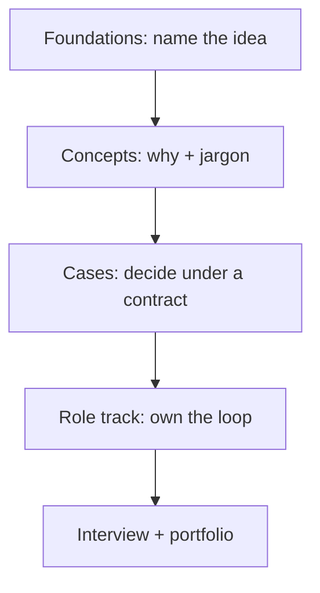

# Technical Studio

> [!info] October 13, 2026 update
> New cases: [[Case - Agent Memory Incident]] and [[Case - Routing Quality and Capacity]]. Choose your evidence artifact in [[Technical Role Practice Workbook — October 2026]].

> [!abstract] Outcome
> Learn the technical ideas, then rehearse the decisions. [[Technical Skills Hub]] teaches core concepts, why they exist, and the jargon. Each case then gives a bounded problem, a contract, constructed teaching numbers, and a ship/stop choice. This layer sits between [[Foundations Hub]] and a role in [[Technical AI Careers]].

> [!info] Not a lab track
> Release 1 deliberately excluded prescriptive labs. The studio keeps that rule. You do not follow steps to produce a demo. You work a case the way a senior engineer would: define the contract, compare interventions, measure, choose, and write the decision. Code appears only as an **inspectable artifact** you can critique.

## Why this layer exists

[[Foundations Hub]] names the ideas. [[Technical Skills Hub]] explains why they exist and what the jargon means. [[Technical AI Careers]] teaches ownership. Cases force a choice under incomplete evidence.

## How to use it

1. Walk the concept spine in [[Technical Skills Hub]] (sixteen notes, in order).
2. Keep [[AI Glossary]] open. Say each new word aloud in a non-engineer sentence.
3. Read [[How to Study a Technical Case]] once.
4. Work one case closed-note: contract, options, decision, then the worked path.
5. Score yourself with the rubric. File a [[Decision Record Template]].
6. Only then open the matching role profile.

## Concept spine

Start here if a term is fuzzy. Full order and “why this note” lives in [[Technical Skills Hub]].

1. [[Tokens, Context, and Cost]]
2. [[Leakage and Contamination]]
3. [[Metrics That Decide]]
4. [[Attention, Memory, and Inference]]
5. [[Context Engineering]]
6. [[Structured Outputs and Contracts]]
7. [[Retrieval Quality]]
8. [[Adaptation Methods]]
9. [[Embeddings and Similarity]]
10. [[The Training Loop]]
11. [[The Agent Loop]]
12. [[Untrusted Context and Injection]]
13. [[Sampling and Decoding]]
14. [[Calibration]]
15. [[Quantization]]
16. [[Vision and Multimodal Systems]]

## Case index

| Case | Decision you practice | Primary roles |
|---|---|---|
| [[Case - Prompt RAG Fine-Tune]] | Which intervention closes the actual gap? | [[AI Engineer]], [[LLM Engineer]], [[RAG and Knowledge Engineer]] |
| [[Case - Evaluation Harness]] | What evidence is enough to ship or stop? | [[AI Evaluation Engineer]], [[LLM Engineer]], [[AI Engineer]] |
| [[Case - Agent Permissions]] | What can the model request versus what the system may do? | [[Agentic AI Engineer]], [[AI Security Engineer]], [[AI Engineer]] |
| [[Case - Serving Capacity]] | Can this SLO be met at the stated cost? | [[Inference and Performance Engineer]], [[LLM Engineer]], [[AI Platform Engineer]] |
| [[Case - Retrieval Failure Autopsy]] | Which layer actually failed? | [[RAG and Knowledge Engineer]], [[AI Evaluation Engineer]], [[AI Engineer]] |
| [[Case - Split Integrity]] | Is this score honest enough to ship? | [[ML Engineer]], [[AI Evaluation Engineer]], [[Data Scientist - AI ML]] |
| [[Case - Vision Field Slice]] | Does the night/camera slice meet the contract? | [[Computer Vision Engineer]], [[AI Evaluation Engineer]] |
| [[Case - Azure DevOps Foundry Release Gate]] | Can this agent change safely reach production? | [[AI Platform Engineer]], [[MLOps Engineer]], [[Agentic AI Engineer]], [[AI Evaluation Engineer]] |
| [[Case - Edge AI Platform Choice]] | Which platform boundary makes this agent safer and more operable? | [[AI Platform Engineer]], [[Agentic AI Engineer]], [[MLOps Engineer]], [[AI Security Engineer]] |
| [[Case - OWASP Agentic Security Review]] | Can this tool-using, memory-bearing agent be piloted without crossing unsafe trust boundaries? | [[AI Security Engineer]], [[Agentic AI Engineer]], [[AI Evaluation Engineer]], [[AI Platform Engineer]] |
| [[Case - Agent Memory Incident]] | What state must be repaired before recovery? | [[Agentic AI Engineer]], [[AI Security Engineer]], [[ML Data Engineer]] |
| [[Case - Routing Quality and Capacity]] | Which route meets quality, risk, cost, and capacity constraints? | [[Inference and Performance Engineer]], [[AI Evaluation Engineer]], [[AI Platform Engineer]] |

## Interview transfer

After two cases, use [[Technical Interview Drills]]. The drills reuse studio contracts so you practice explaining the same decisions under time pressure.

## What “good” looks like

You are ready to leave a case when you can:

- state the owned outcome without naming a vendor;
- name the baseline and why it is the baseline;
- reject at least one fashionable option with a measurement reason;
- report quality **and** an operational or risk metric;
- list the failure that would reverse the decision;
- write a one-page decision record another engineer could operate from.

The scoring rubric lives in [[How to Study a Technical Case]]. The spine does not grow: [[Concept Spine Freeze]]. Sequence: [[Builder 4-Week Syllabus]]. Exam: [[Technical Cumulative Check]]. Pictures: [[Visual Maps Hub]].

## Boundaries

- Studio cases are **teaching scenarios**. Numbers are constructed and labeled. They are not production measurements, vendor benchmarks, or salary/cost quotes.
- Tool names are examples of a class. Prefer the selection method in [[AI Tool Atlas]] over memorizing a stack.
- A completed case is not a portfolio project. Use [[Project Bank]] to produce original evidence.

## Next

Start with [[Technical Skills Hub]], then [[How to Study a Technical Case]]. For the delivery/operations path, read [[AI DevOps and Cloud Engineering — 2026-08-24]], then compare [[Microsoft Azure DevOps and Foundry]] or [[Cloudflare and Vercel AI]] and work the matching release/architecture case. For the interoperability path, read [[MCP Deep Dive — 2026-08-24]] and build one of its projects. For the security path, read [[OWASP and AI Security — 2026]] and work [[Case - OWASP Agentic Security Review]]; otherwise begin with [[Case - Prompt RAG Fine-Tune]].
