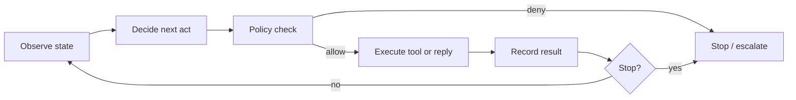

# The agent loop

> [!abstract] Plain idea
> A chatbot answers once. An **agent** repeats: look at state, propose an action, maybe use a tool, write down what happened, decide whether to stop. The loop is the product. If you cannot draw the loop and the stop rules, you do not have an agent — you have a chat UI with extra hope.

## Why this concept exists

“Agent” became a marketing word for any tool call. The useful idea is narrower: **the next step is chosen at run time**, so you must design state, permissions, budgets, and evaluation of *trajectories*, not only final text. The jargon exists so you can talk about those parts instead of arguing about the label.

## When you should not use this loop

If the steps are known (“pull invoice → apply rule → post credit ≤ $25”), a **deterministic workflow** is better: cheaper, auditable, testable. Add a model only on the uncertain step (classify the reason). Full autonomy is a cost and a risk you buy *after* a workflow fails.

## The loop, named

## Jargon

| Term | What it names | Why it exists |
|---|---|---|
| **State** | What is true *now*: user, goal, memory, last tool result. | Without it, every step is amnesia or a prompt dump. |
| **Action / tool call** | A structured request: name + arguments. | Must pass a [[Structured Outputs and Contracts]] schema. |
| **Observation** | What came back (tool output, error, human note). | The next decide step is only as good as this record. |
| **Trajectory** | The full sequence: states, proposals, approvals, results. | Agent evals score this, not only the last sentence. |
| **Stop condition** | Goal met, budget hit, unsafe, user cancel, max steps. | Loops without stops become cost and safety incidents. |
| **Budget** | Max steps, tokens, dollars, or wall time. | Agents multiply [[Tokens, Context, and Cost]]. |
| **Handoff** | Passing the job to another agent or a human. | Specialization; also a new trust boundary. |
| **Planner vs executor** | One component chooses, another does. | Optional. Do not add it until a single loop fails measurably. |
| **Idempotent tool** | Safe to retry. | The network *will* time out mid-loop. |
| **Least autonomy** | Smallest choose-your-own-path surface that works. | Default. |

## Worked teaching budget

> [!warning] Constructed envelope

A “look up invoice and explain a fee” agent.

| Step | Input tokens | Output tokens | Tool |
|---:|---:|---:|---|
| 1 observe + plan | 1,800 | 80 | — |
| 2 get_invoices | 2,000 | 40 | read |
| 3 explain | 2,400 | 180 | — |

One successful run ≈ 6,200 input + 300 output tokens.

If the model gets lost and retries the tool four times, you pay ~4× and you may double-apply a **write** unless tools are idempotent. That is why [[Case - Agent Permissions]] forbids write tools until policy lives *outside* the loop.

**Teaching stop rules:** max 6 steps, $0.05, no write without policy adapter, kill switch.

## What to practice saying

- “Draw the loop. Circle the stop conditions.”
- “Which actions are reads vs writes?”
- “How do we evaluate trajectories, not just the final paragraph?”
- “Why isn’t this a state machine with one model step?”

## Quiz

1. What makes a system agentic rather than a workflow?
2. Why score trajectories?
3. Name three stop conditions that are not “the user is happy.”
4. Why do agents blow token budgets?
5. When is a second agent a bad idea?

> [!question]- Answer key
> 1. The next action is chosen at run time from state, not fully specified in advance. 2. Failures live in tool choice, arguments, extra steps, and policy breaks — not only the last text. 3. Max steps, dollar/token budget, policy deny, tool error budget, human cancel. 4. Each step re-sends a growing window of state and tool dumps. 5. When you have not measured that decomposition beats a single loop plus a workflow; coordination is cost and a new boundary.

## Flashcards

Agent loop:: Observe → decide → policy check → act → record → stop-or-repeat.

State:: The structured facts the next decision is allowed to use.

Trajectory:: The sequence of states, proposals, and results for one run.

Stop condition:: A rule that ends the loop without waiting for a perfect answer.

Least autonomy:: The smallest run-time choice surface that still solves the job.

Handoff:: Transfer of the job to another agent or a human with a defined contract.

Budget:: Caps on steps, tokens, time, or money for one run.

## Transfer

- Next concept: [[Untrusted Context and Injection]].
- Case: [[Case - Agent Permissions]].
- Role: [[Agentic AI Engineer]], [[AI Engineer]].
