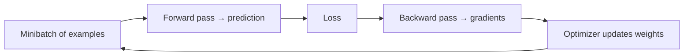

# The training loop

> [!abstract] Plain idea
> Training is a loop: guess, measure how wrong, nudge the weights, repeat. The **loss** is the “how wrong” number the computer can differentiate. The **metric you care about** is often different. When the training loss falls and the held-out metric dies, the model is memorizing, not learning the job.

## Why this concept exists

Without this loop you cannot debug a fine-tune, read a W&B chart, or argue with “the loss went down so we should ship.” Loss is a proxy. Shipping uses a decision metric on held-out data. The jargon names the moving parts so you can point at *which* part broke.

## The loop

That is **one step**. Many steps make an **epoch** (one pass over the training set). Many epochs make a **run**. You keep **checkpoints** (saved weights) because the last step is not always the best one.

## Jargon

| Term | What it names | Why it exists |
|---|---|---|
| **Parameter / weight** | A number the model is allowed to change. | “The model” is mostly a pile of these. |
| **Forward pass** | Compute outputs from current weights. | How you get a prediction or next-token distribution. |
| **Loss** | A scalar the optimizer minimizes (cross-entropy, MSE, …). | Must be smooth enough to differentiate. Need not match the business metric. |
| **Gradient** | How much the loss would change if you nudged each weight. | Points uphill; we usually step the other way. |
| **Learning rate (\(\eta\))** | Step size. | Too big: diverge. Too small: crawl or stall. |
| **Optimizer** | The rule that turns gradients into updates (SGD, Adam, …). | Adaptive methods are default, not magic. |
| **Minibatch** | A small group of examples per step. | Full-dataset gradients are too expensive; batch size changes noise and memory. |
| **Epoch** | One pass through the training set. | A unit for plots and schedules. |
| **Regularization** | Extra pressure not to memorize (weight decay, dropout, early stop). | Because the easy minimum is “copy the training set.” |
| **Overfitting** | Train performance much better than held-out. | The central training failure. |
| **Underfitting** | Model never gets the training set either. | Capacity, data, or optimization is insufficient. |
| **Generalization** | Behavior on new examples from the same job. | The actual goal. |
| **Checkpoint / early stopping** | Save and pick a *previous* step using a validation curve. | Last epoch is often worse. |
| **Learning-rate schedule** | Changing \(\eta\) during the run. | Warmup and decay are common, not ceremonial. |

## Worked teaching curves

> [!warning] Constructed envelope

A 3-class ticket model. You plot **training loss** and **held-out macro-F1** every epoch.

| Epoch | Train loss | Held-out F1 | What it means |
|---:|---:|---:|---|
| 1 | 1.05 | 0.41 | Underfitting; still learning. |
| 3 | 0.48 | 0.72 | Both moving the right way. |
| 5 | 0.22 | **0.78** | Best held-out so far. |
| 8 | 0.09 | 0.74 | Train still improving; held-out slipping. |
| 12 | 0.03 | 0.61 | Classic overfit. Do not ship epoch 12. |

**Decision:** restore the epoch-5 checkpoint. Then ask whether 0.78 F1 is even the contract — if appeal recall is 0.55, you are not done. Loss did its job (it trained). It is not the release metric. See [[Metrics That Decide]] and [[Case - Evaluation Harness]].

If held-out F1 is 0.93 at epoch 2 with a random-row split, suspect [[Leakage and Contamination]] before you celebrate the optimizer.

## What to practice saying

- “Loss is the training signal, not the product metric.”
- “Show train and held-out on the same plot, with the checkpoint you would ship.”
- “What was the learning rate, batch size, and early-stopping rule?”
- “If held-out never moves, I have a data/leakage/objective problem, not an epoch problem.”

## Quiz

1. Why can loss fall while the product metric gets worse?
2. What is an epoch?
3. Why keep checkpoints instead of only the last weights?
4. Underfit vs overfit, in one contrast.
5. Why is a spectacular held-out score on a random-row customer split suspicious?

> [!question]- Answer key
> 1. Loss is a differentiable proxy; it can reward memorization or the wrong class mix. 2. One full pass over the training set. 3. Later steps often overfit; you ship the best validation checkpoint. 4. Underfit: poor even on train. Overfit: great on train, worse on held-out. 5. Identity leakage can make “generalization” a customer-memorization test.

## Flashcards

Loss:: The scalar the optimizer minimizes; a proxy, not the product objective.

Gradient:: The local direction of increase of the loss; updates usually move the other way.

Learning rate:: The step size applied to weight updates.

Epoch:: One pass through the training data.

Minibatch:: The subset of examples used for one update.

Overfitting:: Training performance much better than honest held-out performance.

Checkpoint:: Saved weights at a step; often the one you actually ship.

Early stopping:: Picking an earlier checkpoint using a validation curve.

## Transfer

- Next concept: [[The Agent Loop]].
- Case: [[Case - Split Integrity]].
- Roles: [[ML Engineer]], [[LLM Engineer]], [[AI ML Research Scientist]].
