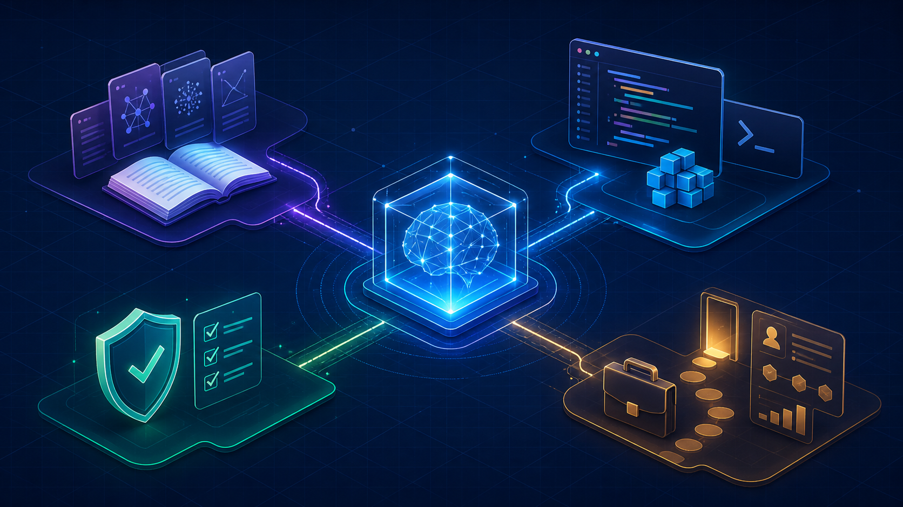

# Everything AI

Everything AI is a United States-focused, evidence-aware study vault for learning, practicing, and interviewing for AI work. It is designed for Obsidian and includes a parallel Notion import layer.



The material is organized around a simple loop:

> Learn the field → choose the role → build evidence → prepare for the interview.

**Latest research refresh: October 13, 2026.** Learn what a role owns, how the underlying systems work, what can fail, and what evidence makes a technical decision defensible. Beginner through advanced material includes explanations, quizzes, flashcards, interview preparation, and suggested projects—not a promise of instant job readiness.

| Inside the vault | Count |
|---|---:|
| Study and reference notes | 235 |
| Role tracks | 63: 23 technical + 40 nontechnical/hybrid |
| Core technical concept notes | 16 |
| Worked technical cases | 12 |
| Flashcard question/answer lines | 1,052 |
| Notes with explicit quizzes or knowledge checks | 145 |
| Mermaid diagrams | 148, plus one Obsidian Canvas |

Counts are reproducible with `ruby scripts/validate_vault.rb`; they describe inventory, not unique assessment items or an official census of AI occupations.

## October refresh

- [Research ledger and release scope](10%20Research/October%202026%20Research%20Refresh.md): checked primary sources, corrections, and remaining review limits.
- [Model and agent lifecycle](05%20Tool%20Atlas/Model%20and%20Agent%20Lifecycle%20Management.md): retirement planning, evaluation exports, paired comparisons, canaries, and fallback.
- [Cloud AI operations](05%20Tool%20Atlas/Cloud%20AI%20Operations%20%E2%80%94%20October%202026.md): Microsoft Foundry, Azure DevOps federation, AWS identity, and operational ownership.
- [MCP upgrade readiness](05%20Tool%20Atlas/MCP%20Contract%20Testing%20and%20Upgrade%20Readiness.md): protocol compatibility, permissions, retries, and persistent business state.
- [Agent-memory incident case](12%20Technical%20Studio/Case%20-%20Agent%20Memory%20Incident.md) and [routing/capacity case](12%20Technical%20Studio/Case%20-%20Routing%20Quality%20and%20Capacity.md): realistic decisions with explicitly synthetic teaching data.
- [Technical role workbook](12%20Technical%20Studio/Technical%20Role%20Practice%20Workbook%20%E2%80%94%20October%202026.md): distinct decisions, portfolio artifacts, and interview challenges for all 23 technical roles.
- [U.S. career and governance update](10%20Research/US%20Career%20and%20Governance%20Update%20%E2%80%94%20October%202026.md): occupation-aware evidence and nontechnical/hybrid practice.

The OWASP dossier now uses the canonical **LLM Top 10 2025** taxonomy and IDs, separately from **Agentic Top 10 2026**. See the research ledger for the source conflict and correction.

## Open in Obsidian

1. Download this repository with **Code → Download ZIP** and extract it, or clone it:

   ```bash
   git clone https://github.com/msinclair25/EverythingAI.git
   ```

2. In Obsidian, choose **Open folder as vault** and select the extracted repository folder—not a Notion ZIP.
3. Open `00 Start Here/Everything AI - Home.md` and follow a learning path.
4. Optionally enable the included `everything-ai` CSS snippet in Appearance. Read any plugin prompt before granting access; no paid plugin is required to read the material.

GitHub is useful for browsing and source review, but Obsidian-specific wikilinks, Bases, and Canvas are best used inside the vault. Standard Markdown and the generated Notion packs provide alternative access.

## What is inside

- Foundations: math, statistics, machine learning, deep learning, transformers, generative AI, RAG, agents, deployment, economics, safety, and policy.
- Core skills: product discovery, data quality, UX, automation, evaluation, threat modeling, accessibility, governance, and AI economics.
- Career map and role tracks: technical, nontechnical, and hybrid roles with responsibilities, workflows, skills, tools, evidence, projects, flashcards, quizzes, and interview prompts.
- Technical studio: inference, tokens and cost, context engineering, retrieval quality, adaptation, quantization, evaluation harnesses, agent permissions, OWASP-oriented security, and design cases.
- Tool atlas: Azure DevOps and Foundry, Cloudflare, Vercel, MCP, model providers, local runtimes, vector search, MLOps, security, observability, and creative tools.
- Assessment center: diagnostic, cumulative checks, quizzes, flashcards, role readiness, and interview preparation.
- Visual maps and builder paths for navigating the material.

## Start here

Open [Everything AI - Home](00%20Start%20Here/Everything%20AI%20-%20Home.md), then choose a path:

1. **New to AI:** [Builder 4-Week Syllabus](00%20Start%20Here/Builder%204-Week%20Syllabus.md)
2. **Choosing a role:** [Choose Your AI Career](00%20Start%20Here/Choose%20Your%20AI%20Career.md)
3. **Technical depth:** [Technical Skills Hub](12%20Technical%20Studio/Technical%20Skills%20Hub.md)
4. **Practice:** [Assessment Center](06%20Assessment%20Center/Assessment%20Center.md)
5. **Notion:** [Notion Import Guide](Notion%20Import%20Guide.md)

For technical depth, take a role profile → its concept prerequisites → a worked case → the October role workbook → a one-page decision record. Explain the failure conditions as clearly as the happy path.

## Notion import

The repository includes a generated full pack and three smaller packs:

- [Notion Import Pack.zip](Notion%20Import%20Pack.zip)
- [Part 1 — Core Learning](Notion%20Import%20Pack%20-%20Part%201%20Core%20Learning.zip)
- [Part 2 — Roles and Practice](Notion%20Import%20Pack%20-%20Part%202%20Roles%20and%20Practice.zip)
- [Part 3 — Tools, Research, and Studio](Notion%20Import%20Pack%20-%20Part%203%20Tools%2C%20Research%2C%20and%20Studio.zip)

Import a ZIP through Notion's **Settings → Import → ZIP** flow. The CSV catalog can be imported separately as a Notion database. Rebuild the packs after vault edits with:

```bash
ruby scripts/export_notion.rb
```

Obsidian Markdown is the canonical source; the Notion layer is a one-way derivative. See [Notion Import Guide](Notion%20Import%20Guide.md) for conversion rules and known differences.

Separate ZIP imports may require cross-part link repair. Mermaid source is preserved as code; do not assume it renders automatically in Notion. Reimporting is not automatic synchronization.

## Repository visuals

The matching [GitHub social preview image](assets/everything-ai-github-social-preview.jpg) is included for repository sharing. Upload it from **Settings → General → Social preview** on GitHub when you want it to appear on shared repository links.

## Evidence and freshness

Research notes use an official-first source policy and record verification and review dates. The latest refresh has an **October 13, 2026** cutoff, with claim-level scope in the research ledger. It is not a claim that every older sentence, price, law, certification, or job posting was reverified. Historical notes retain their dates, and overdue review reminders remain visible.

Prefer official documentation, original research, government statistics, and operative legal text. Separate announcement dates from effective/retirement dates, previews from GA, and hypothetical examples from measured results. Verify current sources before production, purchasing, legal, or career decisions. Free/open tools are included alongside managed/paid options; open-source software does not imply free compute or API usage.

## Working with the vault

The source files are Obsidian Flavored Markdown. Wikilinks, callouts, frontmatter, Mermaid, Bases, Canvas, flashcards, and quizzes are intentional parts of the authoring experience. The `everything-ai` CSS snippet is included for the visual layout used in Obsidian; machine-specific workspace state is ignored.

After editing:

```bash
ruby scripts/validate_vault.rb
ruby scripts/export_notion.rb
git diff --check
```

The scripts use Ruby's standard library; export also needs the system `zip` command. Set `NOTION_AS_OF=YYYY-MM-DD` for a dated reproducible export. The validator checks YAML, code-fence balance, wikilink targets, and local Markdown paths. It does not verify external-source truth, legal applicability, or live Obsidian/Notion rendering.

For corrections, identify the note and claim, provide a primary source and checked date, and explain the affected examples or assessment answers. Do not submit private employer/customer information, secrets, fabricated results, or unlicensed copied material.

## License and reuse

No open-source or Creative Commons license has been selected for this repository yet. Unless a license is added, the contents remain protected by applicable copyright law; viewing the public repository does not grant permission to redistribute or commercially reuse the material.
